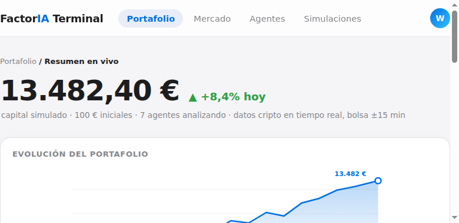
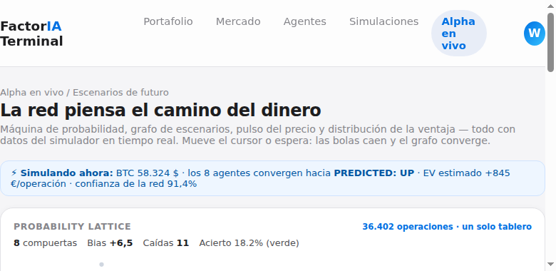
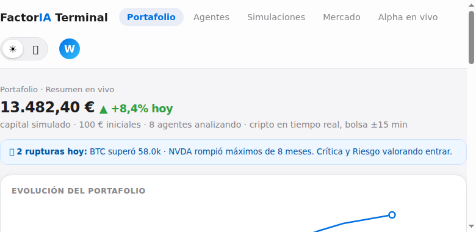
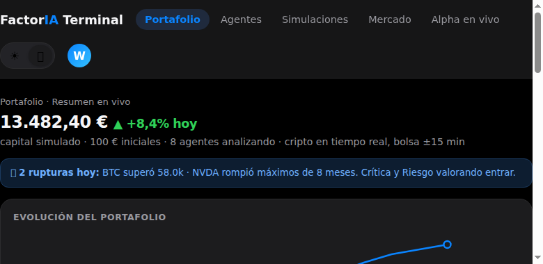

# TradeFactor AI

**A honest, multi-market AI investment simulator with a visible agent swarm, Mirofish future-scenario engine, and an Apple-clean dashboard. Research & paper-trading — built for the truth, not for hype.**

TradeFactor AI simulates what really happens to your money — with real historical data (crypto + stocks + commodities + FX), **real costs per market**, out-of-sample discipline against overfitting, and a team of **8 visible AI agents** (Researcher, Technician, ML Predictor, News, Examiner, Critic, Risk, Executor) that debate before any decision.

## What it does

- **Multi-market data** — Binance (crypto, real-time) + Yahoo Finance (stocks, commodities, FX). 2019→today, daily.
- **Honest backtest engine** — costs (0.08–0.15%/side), no look-ahead, train/test split. A strategy only counts if it beats buy & hold **out-of-sample**.
- **Agent swarm** — each agent publishes what it is doing (momentum, RSI/overbought, out-of-sample backtest, stress test, risk gate). Nothing executes without passing Critic + Risk.
- **Mirofish scenario engine** — forward-return distributions per asset, picks the scenario with the highest probability of success, and tells you entry / target / stop.
- **Historical sweep** — every asset × every strategy, out-of-sample, so you see what actually worked.
- **Apple-clean web UI** — light/dark theme, multi-market tickers, portfolio curves, and the "Alpha live" screen where you watch the agents think (probability lattice, relation graph, price pulse).
- **Paper-first execution** — designed around Alpaca (stocks) and Binance (crypto) via MCP. No real money until you decide.

## Screens

Apple-clean UI, light/dark, with the agents visible while they think.



 

Interactive mockups live in [`mockups/`](mockups/).

## Install (from scratch, anyone can follow)

Prerequisites: Python **3.10+**, and a working internet connection (Binance + Yahoo Finance APIs).

```bash
# 1) clone
git clone https://github.com/jesparbem/tradefactor-ai.git
cd tradefactor-ai

# 2) virtualenv + deps
python3 -m venv .venv
.venv/bin/pip install --upgrade pip
.venv/bin/pip install pandas numpy yfinance

# 3) download historical data (multi-market + AI supply chain)
.venv/bin/python multi_data.py
.venv/bin/python fetch_ia.py

# 4) verify the backtest engine
.venv/bin/python simcore.py        # single-asset honest backtest
.venv/bin/python portsim.py        # multi-asset portfolio

# 5) run the web app
cd web
python3 ../web/server.py            # http://localhost:8766
```

### Run as a service (systemd)

Edit paths to match your clone, save as `/etc/systemd/system/tradefactor.service`, then `systemctl enable --now tradefactor`:

```ini
[Unit]
Description=TradeFactor AI simulator
After=network.target

[Service]
Type=simple
WorkingDirectory=/opt/tradefactor/trading-sim
ExecStart=/usr/bin/python3 /opt/tradefactor/trading-sim/web/server.py
Restart=always

[Install]
WantedBy=multi-user.target
```

### Serve behind Caddy (optional)

```caddyfile
tradefactor.example.com {
    reverse_proxy 127.0.0.1:8766
}
```

## API

| Endpoint | Purpose |
|---|---|
| `POST /api/simulate` | simulate one strategy on one asset |
| `POST /api/genetic` | genetic search (train) + honest out-of-sample report |
| `POST /api/portfolio` | multi-asset portfolio (7 markets, 3 profiles) |
| `POST /api/scenarios` | Mirofish future scenarios + highest-probability pick |
| `POST /api/rotate` | daily-close rotation backtest (no look-ahead) |
| `GET /api/ia` | AI supply-chain sweep (chips + materials) |

## Honest disclaimer

TradeFactor AI is **not financial advice**. It reports what history says with costs included. In our data, **$100 → x10 in a week has never happened** in BTC/ETH since 2019, and a naive "maximize every close" daily-rotation **loses** (churn + costs). A platform that tells you the truth is worth more than one that sells you a dream.

## License

Apache-2.0